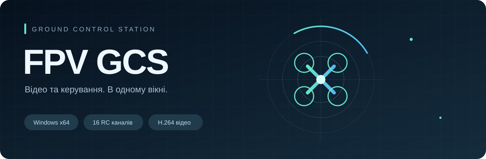

<div align="center">



**Наземна станція для Windows: відео та 16 RC-каналів в одному вікні.**

[](https://github.com/Sokolovskiy/FPV_GCS/releases/latest)


### [⬇ Завантажити EXE для Windows](https://github.com/Sokolovskiy/FPV_GCS/releases/latest/download/FPV-GCS-Setup-0.1.9-win64.exe)

[Portable ZIP](https://github.com/Sokolovskiy/FPV_GCS/releases/latest/download/FPV-GCS-Portable-0.1.9-win64.zip) · [Усі релізи](https://github.com/Sokolovskiy/FPV_GCS/releases) · [Повідомити про проблему](https://github.com/Sokolovskiy/FPV_GCS/issues)

</div>

---

## Встановлення

1. Завантажте **FPV-GCS-Setup-0.1.9-win64.exe** і відкрийте інсталятор.
2. Виберіть українську або англійську мову та встановіть додаток. Права адміністратора не потрібні.
3. Запустіть **FPV GCS** з меню «Пуск».

Qt, SDL і GStreamer включено. Окреме встановлення Python чи SDK не потрібне.
Інсталятор поки не має цифрового підпису видавця; Windows може показати попередження про невідомого видавця.

**Portable:** розпакуйте ZIP повністю й відкрийте `FPV GCS/FPV GCS.exe`.
Зберігайте EXE разом із бібліотеками та підпапками. Контрольні суми — у файлі
`SHA256SUMS.txt` на сторінці релізу.

## Що всередині

| Відео | Керування | Робоче місце |
| --- | --- | --- |
| RTP/H.264 через UDP | 16 незалежних RC-каналів | Темний інтерфейс українською |
| Відображення через Direct3D11 | USB-пульти через SDL та Windows HID | Зміна ширини колонок і відеопанелі |
| Статус сигналу та відновлення приймача | Призначення рухом і локальні профілі | Повноекранний режим **F11** |
| Налаштований jitter buffer: 30 мс | RC через UDP, цільова частота 100 Гц | Один екземпляр додатка |

## Підключення

```text
USB-пульт ──► FPV GCS / Windows ──► Herelink ──► Raspberry Pi
                   ▲                               │
                   └──────── RTP / H.264 ───────────┘
```

| Параметр | Типове значення |
| --- | --- |
| Ethernet-адреса Windows | `192.168.144.3` |
| RC-приймач на Raspberry Pi | `192.168.144.20:14600` |
| Вхідний RTP/H.264 на Windows | UDP `5602` |
| RC-канали | CH1–CH16, `1000–2000` |
| Профілі | `%LOCALAPPDATA%/FPVGCS/FPV GCS/profiles.json` |

Виберіть підключений USB-пульт, перевірте призначення й напрямок кожного каналу.
Для ручного призначення відкрийте налаштування каналу й перемістіть потрібний орган пульта.
Передавач має надавати потрібні канали у своєму режимі USB Joystick.
Звільніть порт `5602`, якщо його використовує інший відеоприймач.

Після втрати USB додаток припиняє RC-пакети; failsafe забезпечує окремий watchdog
на Pi. Відновлення відомого пульта автоматичне, з перевіркою свіжих даних.
Перед використанням перевірте канали та failsafe на стенді зі знятими пропелерами.
100 Гц — цільова частота таймера Windows, а не гарантія реального часу.

## Для розробників

Додаток: **C++20, Qt 6 Widgets, SDL3, GStreamer, CMake/Ninja**.

```powershell
# Зібрати, виконати тести й підготувати папку з бібліотеками
.\fpv-gcs\build.ps1

# Створити EXE-інсталятор, portable ZIP та SHA-256 (потрібен Inno Setup 6)
.\fpv-gcs\tools\package-release.ps1
```

Шляхи до Qt, компілятора, CMake/Ninja та GStreamer можна передати параметрами
`build.ps1`. Типові шляхи й точні версії описані в [технічній документації](fpv-gcs/README.md).
Пакування виконується з чистої тимчасової папки й не включає старі EXE, профілі
або апаратні діагностичні записи. Артефакти з'являються у `fpv-gcs/releases/`.

| Матеріал | Посилання |
| --- | --- |
| Архітектура, протокол, USB та складання | [Технічна документація](fpv-gcs/README.md) |
| Приймач і watchdog Raspberry Pi | [Pi gateway](fpv-gcs/pi/README.md) |
| Встановлення сервісів Pi | [systemd](fpv-gcs/pi/systemd/README.md) |
| Склад релізу та зміни | [Release notes](RELEASE_NOTES.md) |
| Сторонні компоненти й ліцензії | [Third-party notices](fpv-gcs/THIRD-PARTY-NOTICES.md) |

Для цієї збірки пройдено **26 перевірок QtTest**. Вони перевіряють призначення
каналів, профілі, HID, перепідключення та UDP; апаратний тест вашої конфігурації
потрібно виконати окремо. Ліцензії сторонніх бібліотек додано до пакетів у `licenses/`.
