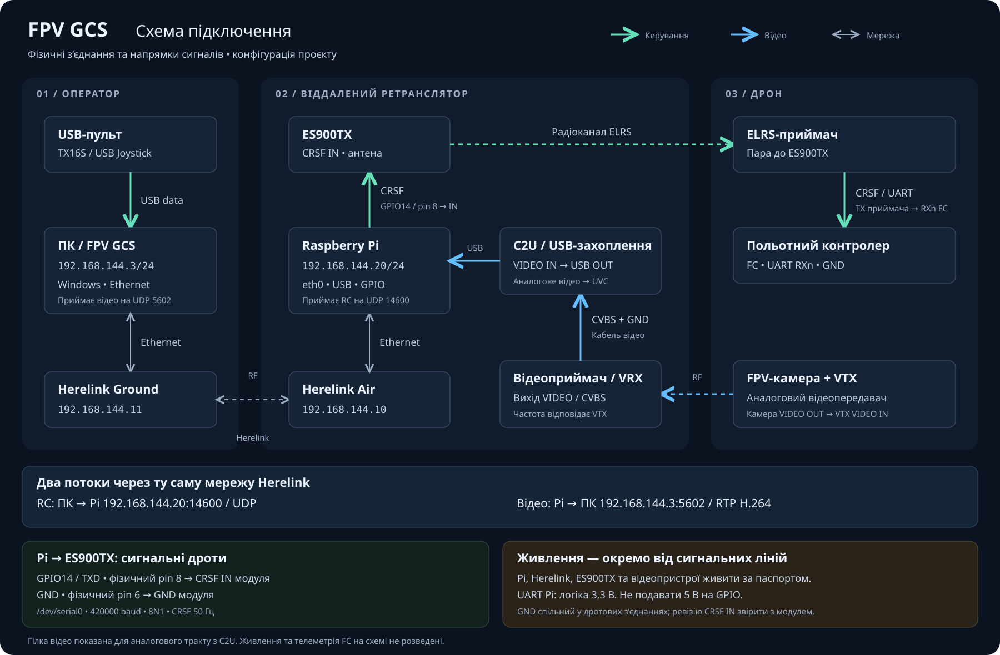

# Схема підключення FPV GCS

## Що куди під’єднати

| Звідки | Куди | Кабель / сигнал |
| --- | --- | --- |
| USB-порт пульта | USB-порт Windows-ПК | USB **з передаванням даних**; режим пульта USB Joystick |
| Ethernet ПК | Ethernet наземного Herelink Ground | Ethernet; відповідний перехідник/кабель для вашої версії Herelink |
| Herelink Ground | Herelink Air біля ретранслятора | Радіоканал спарених блоків Herelink |
| Ethernet Herelink Air | Ethernet `eth0` Raspberry Pi | Ethernet; відповідний кабель для Air Unit |
| Pi GPIO14 / TXD, **фізичний pin 8** | **CRSF IN** окремого ES900TX | UART-сигнал; звірити контакт входу за маркуванням конкретної ревізії модуля |
| Pi GND, **фізичний pin 6** | GND ES900TX | Спільна земля сигнального з’єднання |
| ES900TX з антеною | ELRS-приймач на дроні | Радіоканал ELRS; узгоджені RF-параметри та binding |
| TX ELRS-приймача | RX обраного UART польотного контролера | CRSF; також з’єднати GND. Зворотну телеметрію розводити за документацією приймача та FC |
| VIDEO OUT аналогової FPV-камери | VIDEO IN відеопередавача VTX | Аналогове відео і земля, за документацією пристроїв |
| VTX на дроні | Відеоприймач VRX біля ретранслятора | Радіоканал відео; узгоджені частота та формат |
| VIDEO/CVBS OUT відеоприймача | Аналоговий VIDEO IN C2U | Відеокабель / CVBS і GND |
| USB OUT C2U | USB-порт Raspberry Pi | UVC-пристрій захоплення відео |

ES900TX у цій конфігурації — окремий модуль на ретрансляторі, який отримує CRSF
від Pi. Пульт оператора передає канали в ПК через USB. На схемі не наведено
номер контакту CRSF IN на ES900TX: він має відповідати вашій ревізії модуля.

Гілка VRX → C2U описує **аналогове** відео. Тип конкретного роз’єму (RCA,
TRRS, контактна колодка) потрібно звірити з моделлю VRX/C2U. Код проєкту читає
USB UVC-пристрій ARKMICRO; він не підтверджує розпайку його аналогового кабелю.

## Мережеві адреси й потоки

| Пристрій | Адреса в конфігурації проєкту |
| --- | --- |
| Windows Ethernet | `192.168.144.3`, маска `255.255.255.0` |
| Herelink Ground | `192.168.144.11` — за збереженими звітами стенда |
| Herelink Air | `192.168.144.10` — за збереженими звітами стенда |
| Raspberry Pi `eth0` | `192.168.144.20`, маска `255.255.255.0` |

Адреси `.10/.11` показують досліджені блоки, а не гарантують заводські адреси
будь-якого Herelink. Перевірте адреси своїх пристроїв та відсутність конфліктів.
Для зв’язку ПК і Pi в цій підмережі окремий шлюз Інтернету не потрібен.

- **Керування:** ПК → Herelink Ground → Herelink Air → Pi, UDP `14600`.
  На Pi — CRSF через `/dev/serial0`, `420000 baud`, `8N1`, `50 Гц`.
- **Відео:** C2U → Pi → Herelink Air → Herelink Ground → ПК,
  RTP/H.264, UDP `5602` на адресі `192.168.144.3`.
- Обидва IP-потоки проходять через той самий мережевий міст Herelink.
  Windows має дозволяти вхідне UDP-відео `5602`, Pi — вхідний RC UDP `14600`.
  Wi-Fi у цій схемі для RC не використовується.

## Живлення та перевірка

Кожен пристрій живиться від відповідного джерела за його паспортом. Сигнальний
GPIO Pi не є джерелом живлення ES900TX. Спільна земля потрібна між Pi і ES900TX,
між ELRS RX і FC та в аналогових відеоз’єднаннях. Напругу живлення ES900TX і
розпайку його роз’єму слід брати з документації саме вашого модуля.

GPIO Raspberry Pi працює з логікою **3,3 В**; на GPIO не можна подавати 5 В.
Відповідність TXD/GPIO14 фізичному контакту 8 наведено в
[офіційній документації Raspberry Pi](https://www.raspberrypi.com/documentation/computers/configuration.html#configure-uarts).
Нумерація **BCM GPIO14** та **фізичний pin 8** позначає той самий контакт.

Перед перевіркою керування зніміть пропелери, залиште ARM OFF та підключіть
антену передавача. Схема не вмикає UART і не змінює поточний dry-run/стан сервісів.

Основа схеми: `fpv-gcs/src/udp.cpp`, `fpv-gcs/pi/systemd/launch.py`,
`fpv-gcs/pi/uart_output.py` та збережені апаратні звіти проєкту. З’єднання
камери/VTX/VRX показано як типовий аналоговий тракт для наявного C2U; точні
моделі, роз’єми й живлення цих пристроїв у коді не задані.
